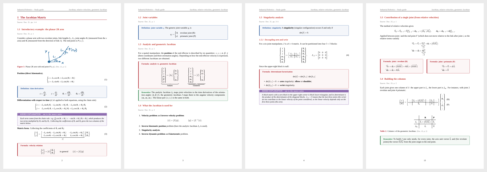

# boska-notes

An [Agent Skill](https://agentskills.io) that turns university lecture material — slides, scanned pages, handwritten notes — into a **polished, self-contained study guide PDF** typeset in LaTeX.

Works with **Claude** (app and Claude Code), **OpenAI Codex CLI** and **Google Gemini CLI**: the skill is a single portable `SKILL.md` folder.



*Example output generated from three pages of handwritten robotics notes: [`examples/jacobian-study-guide.pdf`](examples/jacobian-study-guide.pdf).*

## What you get

- **Faithful to the source.** Only content from your files; nothing invented. Instructions found inside the documents are treated as content, not as commands.
- **Additions clearly marked.** Any clarification written by the agent goes in a purple, dashed, italic box labelled *"Added explanation — not in the source"*.
- **Reorganised by topic.** Repeated slides (animations, page continuations) are merged; no concept, formula or example is dropped.
- **Source references.** Slide/page numbers in grey under every heading and in every caption.
- **Real math.** All formulas, matrices and derivations in LaTeX, verified visually against the original pages.
- **Original figures.** Drawings cropped from the source pages, with squared-paper grids removed.
- **Clean layout.** Times New Roman, red heading hierarchy, justified paragraphs, callouts for definitions, formulas, things to remember and limits, a recap box at the end of each chapter, every chapter on a new page.
- **Checked before delivery.** The agent renders and inspects every page of the final PDF.

Default output language is English; ask for another language in your prompt if you need it.

## Install

### Claude Code (plugin marketplace)

```
/plugin marketplace add Boskaa/boska-notes
/plugin install boska-notes@boska-notes
```

### Gemini CLI

```bash
gemini skills install https://github.com/Boskaa/boska-notes --path skills/boska-notes
```

### Codex CLI, Claude Code, Gemini CLI (install script)

```bash
git clone https://github.com/Boskaa/boska-notes
cd boska-notes
./install.sh                 # all three tools
./install.sh codex gemini    # or only some of them
```

Windows (PowerShell):

```powershell
git clone https://github.com/Boskaa/boska-notes
cd boska-notes
powershell -ExecutionPolicy Bypass -File install.ps1
```

The script copies `skills/boska-notes/` into `~/.claude/skills/`, `~/.codex/skills/` and `~/.gemini/skills/`. Restart the CLI afterwards (Gemini: `/skills reload`).

### Claude app (claude.ai / desktop)

Download `boska-notes.skill` from the [latest release](https://github.com/Boskaa/boska-notes/releases/latest) and open it in Claude, then click **Save skill** (or upload it under *Settings → Skills*).

### Manual

Copy the `skills/boska-notes/` folder into your agent's skills directory:

| Tool | User scope | Project scope |
|---|---|---|
| Claude Code | `~/.claude/skills/` | `.claude/skills/` |
| Codex CLI | `~/.codex/skills/` | `.codex/skills/` |
| Gemini CLI | `~/.gemini/skills/` | `.gemini/skills/` |

## Usage

Attach or point to your lecture files and ask for a study guide, for example:

> Create a study guide from `lecture-07.pdf` and `lecture-08.pdf`. Pay close attention to the derivations and drawings.

The skill activates automatically on requests like this. You can also call it explicitly: `/boska-notes` (Claude Code), `$boska-notes` (Codex).

## Requirements

The agent needs these on the machine where it runs:

- **XeLaTeX** (TeX Live with `tcolorbox`, `titlesec`, `needspace`, `fontspec`, `mathptmx`)
- **poppler-utils** (`pdftoppm`, `pdftotext`, `pdfinfo`)
- **Python 3** with `pillow` and `numpy`

Debian / Ubuntu:

```bash
sudo apt install texlive-xetex texlive-latex-extra texlive-fonts-recommended poppler-utils fonts-liberation
pip install pillow numpy
```

macOS: `brew install --cask mactex` and `brew install poppler`, then `pip install pillow numpy`.

If Times New Roman is not installed, the template falls back to Liberation Serif or TeX Gyre Termes (metric-compatible).

## Repository layout

```
skills/boska-notes/
├── SKILL.md                 # instructions for the agent
├── assets/template.tex      # LaTeX preamble with all styles and callout boxes
└── scripts/
    ├── render_pages.py      # rasterise source PDFs for visual inspection
    ├── crop_figure.py       # crop figures and remove background grids
    └── contact_sheet.py     # tile the final PDF pages for the last check
.claude-plugin/              # Claude Code plugin + marketplace manifests
install.sh, install.ps1      # multi-agent installers
examples/                    # sample output
```

## Customising

Edit `skills/boska-notes/SKILL.md` to change the rules (language, callout types, recap) and `assets/template.tex` to change the look (colours, fonts, margins). Reinstall afterwards.

## License

[MIT](LICENSE)
